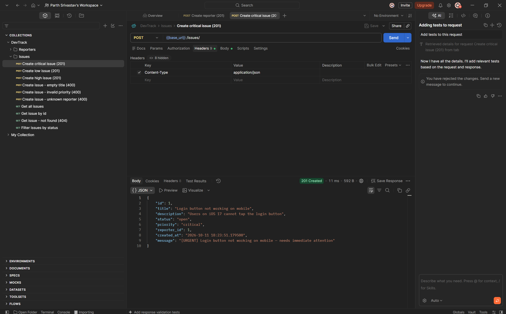
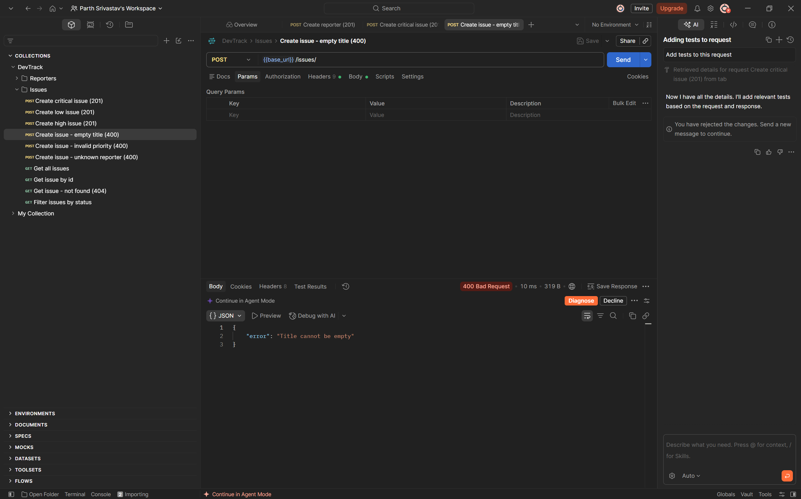
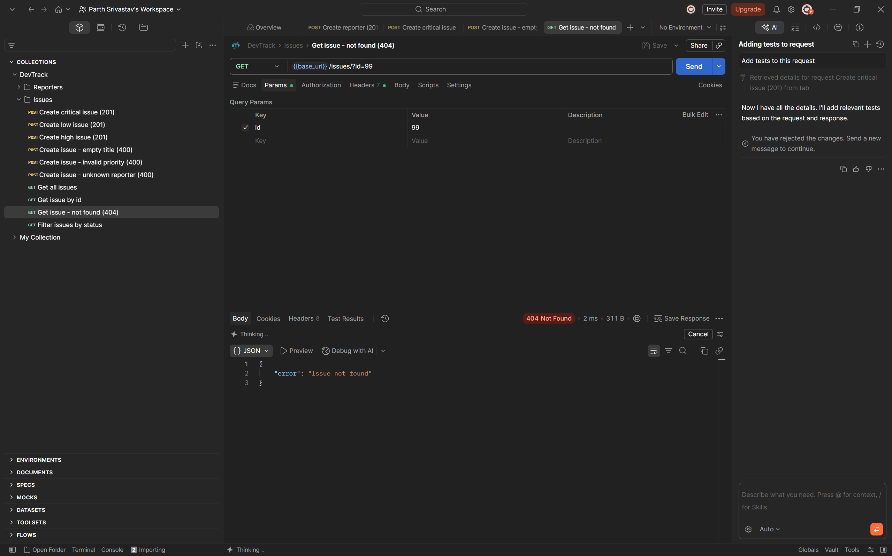

# DevTrack

A minimal backend API for tracking engineering issues — a stripped-down GitHub Issues.
Engineers (**Reporters**) file **Issues**, set priorities, and track status.
Built with Django, plain Python OOP classes, and JSON-file storage.

## Project structure

```
devtrack/
├── manage.py
├── issues.json            # Issue records
├── reporters.json         # Reporter records
├── devtrack/
│   ├── settings.py        # 'issues' registered in INSTALLED_APPS
│   └── urls.py            # mounts issues.urls under /api/
├── issues/
│   ├── models.py          # BaseEntity, Reporter, Issue, CriticalIssue, LowPriorityIssue
│   ├── views.py           # request handling + JSON persistence
│   ├── urls.py            # /api/reporters/, /api/issues/
│   └── tests.py
├── postman/DevTrack.postman_collection.json
└── screenshots/           # Postman screenshots
```

## How to run

```bash
git clone https://github.com/SriParth-alt/devtrack.git
cd devtrack
python -m venv venv
# Windows: venv\Scripts\activate    macOS/Linux: source venv/bin/activate
pip install -r requirements.txt
python manage.py runserver
```

The API is now at `http://127.0.0.1:8000/api/`. No migrations are needed — data lives in
`issues.json` and `reporters.json` in the project root.

Run the tests (they use temporary files, so your data is untouched):

```bash
python manage.py test issues
```

**Postman:** import `postman/DevTrack.postman_collection.json` — it has every request below,
in order (create a reporter first, since issues must reference an existing reporter).

## Data model

| Reporter | | Issue | |
|---|---|---|---|
| `id` | int | `id` | int |
| `name` | string | `title` | string |
| `email` | string | `description` | string |
| `team` | string (backend, frontend, devops…) | `status` | `open` · `in_progress` · `resolved` · `closed` |
| | | `priority` | `low` · `medium` · `high` · `critical` |
| | | `reporter_id` | int → Reporter.id |
| | | `created_at` | `str(datetime.now())`, set by the server |

One Reporter → many Issues. The link is stored on the Issue (`reporter_id`).

## OOP design (`issues/models.py`)

- **`BaseEntity`** (abstract, `ABC`) — declares `validate()` as an `@abstractmethod` and
  implements a shared `to_dict()`.
- **`Reporter(BaseEntity)`** — name not empty, email contains `@`, team not empty.
- **`Issue(BaseEntity)`** — title not empty, status and priority from the allowed sets,
  `describe()` returns `"<title> [<priority>]"`.
- **`CriticalIssue(Issue)`** / **`LowPriorityIssue(Issue)`** — override `describe()`.

`POST /api/issues/` picks the class by priority (`critical` → `CriticalIssue`, `low` →
`LowPriorityIssue`, `medium`/`high` → `Issue`), calls `validate()`, stores `to_dict()`,
and adds `describe()` to the response as `message`.

## Endpoints

| Method | URL | What it does | Success | Errors |
|---|---|---|---|---|
| POST | `/api/reporters/` | Create a reporter | 201 + reporter | 400 invalid field / duplicate id / bad JSON |
| GET | `/api/reporters/` | List all reporters | 200 + list | — |
| GET | `/api/reporters/?id=1` | Get one reporter | 200 + reporter | 404 `Reporter not found`, 400 non-integer id |
| POST | `/api/issues/` | Create an issue | 201 + issue + `message` | 400 invalid field / unknown reporter / duplicate id / bad JSON |
| GET | `/api/issues/` | List all issues | 200 + list | — |
| GET | `/api/issues/?id=1` | Get one issue | 200 + issue | 404 `Issue not found`, 400 non-integer id |
| GET | `/api/issues/?status=open` | Issues with that status | 200 + list (may be empty) | 400 invalid status |

Any other HTTP method returns `405 Method not allowed`. `id` is optional on POST — if it is
omitted the server assigns the next free one.

### Example — `POST /api/issues/`

Request:

```json
{
  "id": 1,
  "title": "Login button not working on mobile",
  "description": "Users on iOS 17 cannot tap the login button",
  "status": "open",
  "priority": "critical",
  "reporter_id": 1
}
```

`201 Created`:

```json
{
  "id": 1,
  "title": "Login button not working on mobile",
  "description": "Users on iOS 17 cannot tap the login button",
  "status": "open",
  "priority": "critical",
  "reporter_id": 1,
  "created_at": "2026-10-11 15:41:40.457783",
  "message": "[URGENT] Login button not working on mobile — needs immediate attention"
}
```

`400 Bad Request` (empty title): `{"error": "Title cannot be empty"}`
`404 Not Found` (`GET /api/issues/?id=99`): `{"error": "Issue not found"}`

## Postman screenshots

**Success — `POST /api/issues/` (201 Created)**



**Failure — `POST /api/issues/` with empty title (400 Bad Request)**



**Failure — `GET /api/issues/?id=99` (404 Not Found)**



## Design decision: the issue must belong to a real reporter

The brief says one Reporter files many Issues, with `reporter_id` stored on the Issue. With
JSON files there is no database foreign key, so nothing would stop an issue pointing at
reporter 42 when only reporter 1 exists — an orphaned record that can never be traced back
to whoever filed it. So `POST /api/issues/` checks `reporters.json` and returns
`400 {"error": "Reporter with id 42 does not exist"}` if there's no match. That keeps the
1:many relationship true in the data, not just on paper.

This check lives in the view, not in `Issue.validate()`, on purpose: `validate()` only checks
the object's own fields, so the model classes don't need to know where data is stored.
Anything that needs to read storage stays in `views.py`.

Two smaller choices that support this:

- **Duplicate ids are rejected (400)**, since the brief's lookup loop assumes `id` is unique.
- **File writes are atomic and locked:** each POST reads the file, appends, writes to a temp
  file and swaps it in with `os.replace`, under a lock, so a crash or two requests at once
  can't corrupt or lose records.
